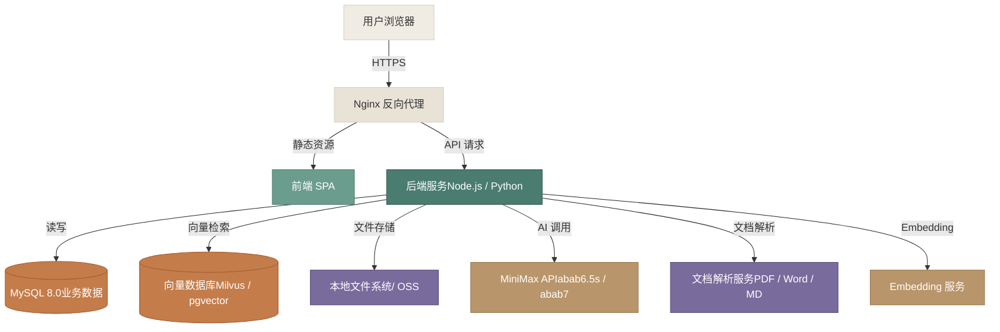
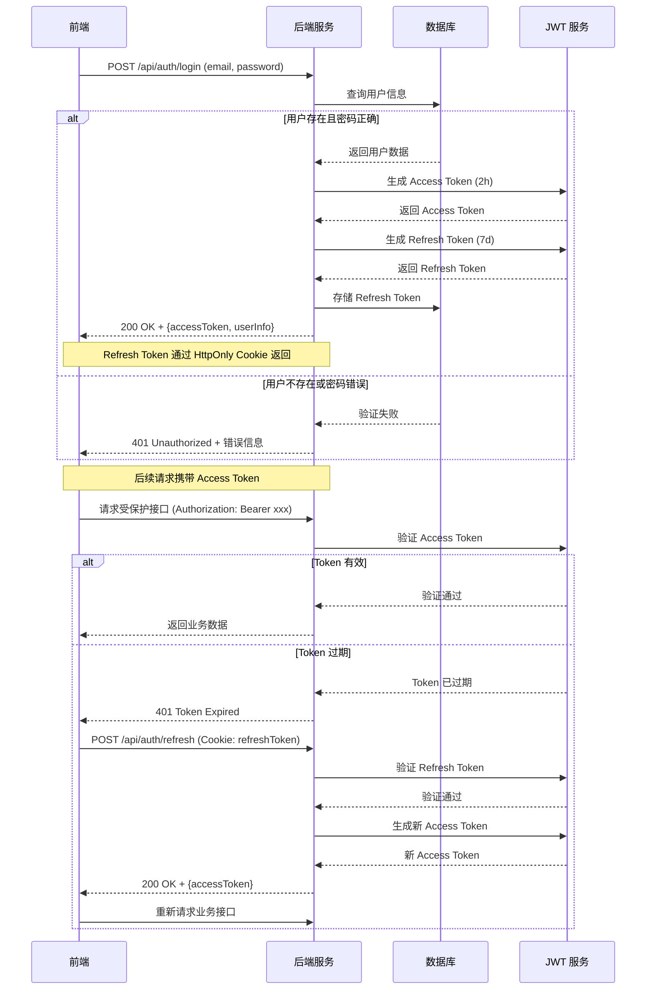
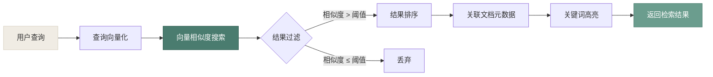
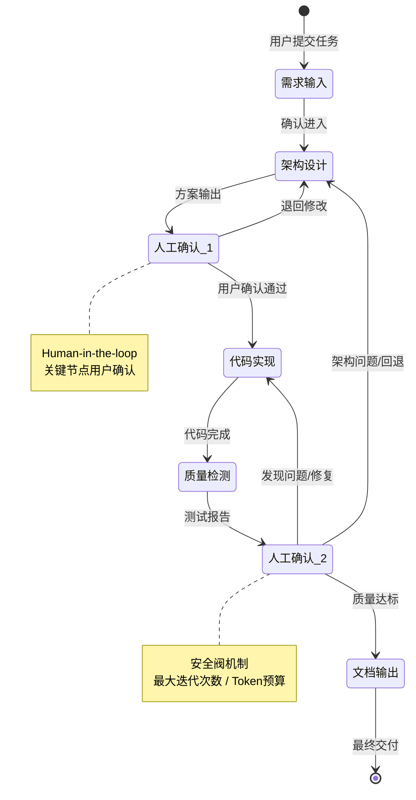
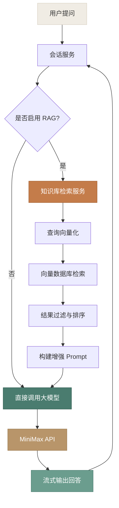

# 青萍小台 产品需求说明书 (PRD)

> **文档编号**: QPT-PRD-2026-001  
> **版本**: v1.0  
> **日期**: 2026-07-13  
> **阶段**: MVP  

> 个人 AI 工作台 -- 以知识库为底座，以多智能体专家组为核心，为个人创作者与独立开发者打造的一站式 AI 效率平台

---

## 目录

- [01 文档概述](#文档概述)
- [02 产品背景与目标](#产品背景与目标)
- [03 用户画像](#用户画像)
- [04 产品概述](#产品概述)
- [05 功能需求 - 用户系统](#功能需求--用户系统)
- [06 功能需求 - 知识库模块](#功能需求--知识库模块)
- [07 功能需求 - 技术专家组](#功能需求--技术专家组)
- [08 功能需求 - 系统管理](#功能需求--系统管理)
- [09 非功能需求](#非功能需求)
- [10 数据需求](#数据需求)
- [11 接口需求](#接口需求)
- [12 验收标准](#验收标准)
- [13 里程碑与排期](#里程碑与排期)

## 文档概述

### 1.1 文档目的

本文档为 **"青萍小台"** 个人 AI 工作台产品的官方产品需求说明书（Product Requirements Document, PRD）。 文档旨在清晰、完整地定义产品的功能需求、非功能需求、数据需求和接口需求， 为研发团队、设计团队、测试团队提供统一的需求基线和验收依据。

通过本文档，相关干系人可以了解产品定位、目标用户、核心价值主张以及 MVP 版本的完整功能范围， 确保产品开发过程中的需求一致性和可追溯性。

### 1.2 文档范围

#### 包含范围 `IN SCOPE`

- 用户注册 / 登录 / 个人中心 / JWT 认证
- 知识库管理（文档上传、文本解析、向量存储、语义检索）
- 技术专家组（四大专家角色、多智能体协作、状态图式协作）
- SSE 流式输出与会话管理
- 知识库 RAG 接入
- 系统管理（插件管理、菜单动态加载、系统配置）
- RESTful API 与 SSE 流式接口规范
- MVP 版本里程碑规划

#### 不包含范围 `OUT OF SCOPE`

- 多租户 / SaaS 化部署（仅支持单用户部署）
- 移动端 App（仅提供 Web 端响应式布局）
- 付费订阅与支付系统
- 团队协作与权限分级
- 语音识别与语音合成（仅预留接口）
- 图像生成能力（仅预留接口）
- 第三方 OAuth 登录（仅支持邮箱+密码）

### 1.3 目标读者

#### 产品经理

需求评审、范围管理、优先级排序、迭代规划

#### 开发工程师

架构设计、功能实现、接口开发、数据库设计

#### UI/UX 设计师

界面设计、交互原型、用户体验优化

#### 测试工程师

测试用例编写、功能验证、性能与安全测试

### 1.4 术语定义

- **RAG**: Retrieval-Augmented Generation，检索增强生成。通过从知识库中检索相关文档片段，增强大模型生成回答的准确性和时效性。
- **SSE**: Server-Sent Events，服务器推送事件。一种基于 HTTP 的服务器向客户端单向推送数据的技术，用于实现流式输出效果。
- **JWT**: JSON Web Token，一种基于 JSON 的开放标准令牌，用于在各方之间安全地传输信息，常用于用户身份认证。
- **Embedding**: 向量嵌入。将文本转换为高维空间中的向量表示，用于计算文本相似度和进行语义检索。
- **多智能体**: Multi-Agent，多个具有不同角色和能力的 AI 智能体协同工作，通过分工与协作完成复杂任务。
- **知识库**: Knowledge Base，存储结构化和非结构化知识的集合，支持文档上传、解析、向量化和语义检索。
- **MVP**: Minimum Viable Product，最小可行产品。用最少的功能集合验证产品核心价值的产品版本。
- **MiniMax**: 国内大模型服务商，提供 abab6.5s / abab7 文本模型、语音模型和图像生成模型能力。
- **状态图式协作**: State Graph Collaboration，基于状态图的多智能体协作模式。专家之间以状态节点形式组织，支持顺序推进、回退、循环和跳转，关键节点可引入人工介入确认，替代传统单向流水线模式。
- **流水线工作流**: Pipeline Workflow，将任务分解为多个串行步骤，每个步骤由特定的智能体处理，形成自动化处理流程。（注：本产品已升级为状态图式协作模式）
- **向量数据库**: 专门存储和检索向量嵌入的数据库系统，支持相似度搜索，本方案中使用 MySQL + 向量扩展或 Milvus。

### 1.5 版本记录

- **v1.0** | 2026-07-13 — 初始版本，完成 MVP 完整需求定义，包含用户系统、知识库模块、技术专家组、系统管理四大功能模块。 (创建人：产品团队)

## 产品背景与目标

### 2.1 产品背景

随着大语言模型技术的快速发展，AI 工具已经从"新奇尝鲜"进入"日常生产力"阶段。 然而，对于个人创作者、独立开发者和知识工作者而言，当前的 AI 工具市场存在以下矛盾：

#### 通用 vs 专业

通用 AI 助手（如 ChatGPT、Claude）功能全面但缺乏针对性，无法深度适配个人工作流

#### 知识割裂

个人知识分散在笔记、文档、浏览器收藏夹中，无法与 AI 能力有效结合

#### 工具碎片化

写作、编程、研究、设计需要切换多个平台，上下文断裂，效率低下

**核心洞察：**个人用户需要的不是另一个聊天机器人，而是一个"懂自己"的 AI 工作台 —— 它了解用户的知识体系、工作习惯和目标追求，像一个专属智囊团一样持续赋能。

### 2.2 问题分析

| 问题编号 | 问题描述 | 影响程度 | 发生频率 | 对应解决方案 |
| --- | --- | --- | --- | --- |
| P-001 | 个人知识资产分散，无法被 AI 有效利用，导致回答缺乏个人特色和深度 | 高 | 每日 | 知识库模块 + RAG 检索增强 |
| P-002 | 通用 AI 对话缺乏角色分工，复杂任务需要反复切换 Prompt 和上下文 | 高 | 每日 | 技术专家组 + 多智能体协作 |
| P-003 | 跨工具切换导致上下文断裂，每次使用 AI 都需要重新铺垫背景 | 高 | 每日 | 工作台统一入口 + 会话上下文管理 |
| P-004 | 文档处理效率低，PDF/Word 等格式内容难以快速提取和检索 | 中 | 每周多次 | 多格式文档解析 + 语义检索 |
| P-005 | 现有 AI 工具多为 SaaS 模式，数据存储在第三方，隐私和安全有顾虑 | 中 | 持续 | 私有化部署 + 数据完全可控 |
| P-006 | 个人工作流无法自动化，重复性任务消耗大量时间 | 中 | 每周多次 | 状态图式协作 + 插件扩展机制 |

### 2.3 产品目标

- **30min**: 从部署到上手使用的时间
- **4+**: 核心专家角色，覆盖主要创作场景
- **95%**: 常见文档格式解析成功率
- **<2s**: 知识库语义检索响应时间

#### 短期目标（MVP 阶段） `0-3 个月`

- 完成核心三大模块：用户系统、知识库、技术专家组
- 支持 Markdown / PDF / TXT / Word 四种主流文档格式
- 实现四大专家角色的基础协作能力
- 支持 SSE 流式输出，提供流畅的对话体验
- 完成私有化部署方案，支持一键部署到云服务器

#### 中期目标（成长阶段） `3-6 个月`

- 扩展专家角色至 8+ 个，覆盖更多专业领域
- 支持更多文档格式（PPT、Excel、Epub、网页剪藏）
- 完善插件生态，支持第三方插件接入
- 优化多智能体协作效率和质量
- 引入语音和图像生成能力

#### 长期目标（成熟阶段） `6-12 个月`

- 打造完整的个人 AI 操作系统
- 支持自定义智能体创建和训练
- 构建开放的插件市场和模板社区
- 探索多模态知识管理能力

### 2.4 成功指标

| 指标类别 | 指标名称 | 定义 | 目标值 | 衡量方式 |
| --- | --- | --- | --- | --- |
| 产品价值 | 日活跃用户数（DAU） | 每日至少使用一次核心功能的用户数 | MVP 上线后 3 个月 DAU > 500 | 用户行为日志统计 |
| 人均会话数 | 平均每个活跃用户每日发起的对话轮次 | > 15 轮 / 人 / 天 | 对话数据统计 |  |
| 功能使用 | 知识库文档量 | 平均每个用户上传的知识库文档数量 | > 20 篇 / 人 | 数据库统计 |
| 智能体使用率 | 使用技术专家组功能的用户占比 | > 60% 的活跃用户 | 用户行为日志统计 |  |
| 性能体验 | 首屏加载时间 | 用户访问到页面可交互的时间 | < 2 秒（4G 网络） | 前端性能监控 |
| SSE 首字节时间 | 发起对话到收到第一个流式响应的时间 | < 1.5 秒 | 接口响应日志 |  |
| 用户满意度 | NPS 净推荐值 | 用户向他人推荐产品的意愿程度 | NPS > 40 | 用户调研问卷 |
| 用户留存率 | 次日 / 7 日 / 30 日留存率 | 次日 > 60% / 7日 > 35% / 30日 > 20% | 用户行为分析 |  |

## 用户画像

### 3.1 目标用户群

青萍小台的核心目标用户是 **以知识工作和创意生产为核心的个人用户**， 他们对 AI 工具有较高的接受度，追求效率提升和知识沉淀， 同时重视数据隐私和工具的个性化定制能力。

#### 独立开发者

一人公司 / 自由职业开发者，需要快速查阅技术文档、生成代码、撰写项目文档

#### 内容创作者

博主 / 作家 / 自媒体人，需要大量的素材整理、内容规划和文稿撰写辅助

#### 研究者 / 分析师

学术研究者 / 行业分析师，需要处理大量文献资料、进行深度分析和报告撰写

### 3.2 核心用户画像

#### 李明 · 独立全栈开发者

> 主要用户 · PERSONA-01

*28岁 | 自由职业 | 技术栈广泛 | 效率控*

**背景与目标**

- 3 年全栈开发经验，目前独立接单
- 同时维护 3-5 个项目，技术栈包括 React、Node.js、Python
- 希望减少重复劳动，把更多时间用在创造性工作上
- 关注数据安全，不愿意把客户项目代码上传到公共 AI 服务

**痛点与需求**

- 经常需要查阅项目文档和技术规范，搜索效率低
- 写代码时频繁切换编辑器、浏览器、文档工具
- 项目交付文档编写耗时，希望 AI 能辅助生成
- 需要一个能"理解"自己项目代码的 AI 助手

#### 张小雨 · 自媒体创作者

> 主要用户 · PERSONA-02

*32岁 | 内容创业者 | 多平台运营 | 知识付费*

**背景与目标**

- 运营个人公众号和小红书账号，粉丝 10w+
- 主打职场成长和效率工具类内容
- 每周产出 3-5 篇原创文章，同时制作短视频脚本
- 希望建立个人知识库，系统化管理素材和灵感

**痛点与需求**

- 素材分散在各处，写文章时找资料很费劲
- 同一主题需要适配不同平台的写作风格
- 选题策划和大纲撰写耗时长，希望 AI 辅助
- 需要一个懂自己写作风格的 AI 写作伙伴

#### 王博士 · 行业研究员

> 次要用户 · PERSONA-03

*35岁 | 咨询公司 | 新消费赛道 | 深度阅读*

**背景与目标**

- 某咨询公司高级研究员，专注新消费领域
- 每月阅读 30+ 篇行业报告和学术论文
- 需要快速梳理信息、提炼观点、撰写研究报告
- 重视信息来源的准确性和可追溯性

**痛点与需求**

- 文献资料太多，难以系统管理和快速检索
- 跨文档对比分析工作量大，效率低下
- 写报告时需要频繁引用数据和观点，整理困难
- 需要 AI 辅助进行文献综述和观点提炼

### 3.3 用户痛点汇总

| 痛点编号 | 痛点描述 | 涉及用户 | 严重程度 | 对应功能 |
| --- | --- | --- | --- | --- |
| P-01 | 个人知识资产分散在多个平台，无法统一管理和高效检索 | 全部用户 | ★★★ | 知识库模块 |
| P-02 | 通用 AI 助手不懂个人上下文，每次使用需要重复铺垫背景 | 全部用户 | ★★★ | RAG 检索 + 会话上下文 |
| P-03 | 复杂任务需要多轮引导，单角色 AI 能力有限 | 开发者 / 研究者 | ★★★ | 技术专家组 / 多智能体协作 |
| P-04 | 数据存储在第三方 SaaS 平台，隐私安全无法保障 | 开发者 / 研究者 | ★★☆ | 私有化部署 |
| P-05 | 不同类型的写作需要切换不同工具，工作流断裂 | 创作者 / 研究者 | ★★☆ | 统一工作台 / 多专家角色 |
| P-06 | 文档格式多样（PDF/Word/Markdown），内容提取和整理困难 | 全部用户 | ★★☆ | 多格式解析 |
| P-07 | AI 回答缺乏可追溯的来源引用，难以验证准确性 | 研究者 / 开发者 | ★★☆ | RAG 来源标注 |

## 产品概述

### 4.1 产品定位

**青萍小台** —— 面向个人知识工作者的私有化 AI 工作台， 以知识库为数据底座，以多智能体专家组为能力核心， 帮助用户构建"懂自己"的 AI 效率系统。

#### 私有化部署

部署在自己的云服务器上，数据完全自主可控，无第三方数据隐私风险

#### 知识库驱动

将个人知识资产转化为 AI 可理解的向量数据库，让 AI 真正"懂你"

#### 多智能体协作

不同角色的 AI 专家分工协作，像一个智囊团一样处理复杂任务

### 4.2 核心价值主张

| 价值维度 | 价值描述 | 用户收益 |
| --- | --- | --- |
| 效率提升 | 通过多智能体协作和知识库 RAG，将重复性知识工作自动化 | 节省 50%+ 的文档处理和信息整理时间 |
| 知识沉淀 | 个人文档统一管理、向量化存储、语义检索 | 知识资产可积累、可复用、可演化 |
| 数据安全 | 私有化部署模式，数据完全存储在用户自有服务器 | 消除数据隐私顾虑，放心使用敏感资料 |
| 个性化 | 基于个人知识库的 RAG 增强，AI 回答贴合个人语境 | 获得"最懂自己"的 AI 助手体验 |
| 可扩展性 | 插件化架构，支持自定义专家角色和功能扩展 | 工作台随个人成长持续进化 |

### 4.3 产品形态

青萍小台采用 **B/S 架构**，以 Web 应用形态交付，支持用户在自己的云服务器上私有化部署。 前端为单页应用（SPA），后端提供 RESTful API 和 SSE 流式接口。



*图 4-1 产品整体技术架构图*

#### 技术栈说明

**前端技术栈**

- 框架：React 18 + TypeScript
- 构建：Vite 5.x
- UI 组件库：Ant Design 5.x 或自研组件库
- 状态管理：Zustand / Redux Toolkit
- Markdown 渲染：react-markdown + 语法高亮
- SSE 通信：EventSource API

**后端技术栈**

- 框架：Node.js (NestJS) 或 Python (FastAPI)
- 数据库：MySQL 8.0
- 向量数据库：Milvus Lite 或 MySQL 向量扩展
- 认证：JWT + Refresh Token
- AI 服务：MiniMax API（abab6.5s / abab7）
- 文档解析：pdf-parse / mammoth / markdown-it

## 功能需求 · 用户系统

### 5.1.1 功能总览

用户系统是青萍小台的基础模块，负责用户身份管理、认证鉴权和个人信息维护。 MVP 阶段支持邮箱注册 + 密码登录，采用 JWT 认证机制，确保 API 访问安全。

#### 用户注册

邮箱 + 密码注册，邮箱验证，密码强度校验

#### 用户登录

邮箱密码登录，JWT 双令牌机制，记住登录状态

#### 个人中心

个人信息管理、头像设置、密码修改

#### API 配置

MiniMax API Key 配置、模型选择、参数设置

### 5.1.2 用户注册

| 功能点 | 详细描述 | 业务规则 | 优先级 |
| --- | --- | --- | --- |
| 注册表单 | 用户通过邮箱和密码创建账号 | 邮箱格式校验 密码长度 8-32 位，需包含字母和数字 确认密码与密码一致 | P0 |
| 邮箱唯一性校验 | 注册时实时检查邮箱是否已被注册 | 邮箱不区分大小写，全局唯一 | P0 |
| 邮箱验证 | 注册后发送验证邮件，用户点击链接激活账号 | 验证链接有效期 24 小时 未验证账号可登录但部分功能受限 支持重新发送验证邮件 | P1 |
| 密码加密存储 | 用户密码使用 bcrypt 加密后存储 | bcrypt cost factor = 12，禁止明文存储 | P0 |
| 初始配置引导 | 新用户首次登录后引导配置 MiniMax API Key | 未配置 API Key 时无法使用 AI 相关功能 | P0 |

### 5.1.3 用户登录与认证

| 功能点 | 详细描述 | 业务规则 | 优先级 |
| --- | --- | --- | --- |
| 邮箱密码登录 | 用户使用注册邮箱和密码登录系统 | 连续 5 次登录失败锁定账号 15 分钟 登录成功记录登录时间和 IP | P0 |
| JWT Access Token | 登录成功后签发短期访问令牌 | 有效期：2 小时 算法：HS256 存储：HttpOnly Cookie 或 LocalStorage | P0 |
| Refresh Token | 刷新令牌用于无感续期 Access Token | 有效期：7 天 存储在 HttpOnly Cookie 中 支持主动吊销 | P0 |
| 令牌自动续期 | Access Token 过期前自动刷新 | 过期前 5 分钟触发续期 Refresh Token 过期则跳转登录页 | P0 |
| 记住登录 | "记住我"选项延长登录状态 | 勾选后 Refresh Token 有效期延长至 30 天 | P1 |
| 退出登录 | 用户主动登出，清除令牌 | 清除客户端令牌 服务端将 Refresh Token 加入黑名单 | P0 |
| 忘记密码 | 通过邮箱验证码重置密码 | 验证码有效期 30 分钟 同一邮箱 1 分钟内最多发送 1 次 | P1 |
| API 鉴权中间件 | 所有需要登录的接口校验 JWT 有效性 | 白名单接口：注册、登录、静态资源 无效令牌返回 401 状态码 | P0 |



*图 5-1 JWT 认证与刷新流程图*

### 5.1.4 个人中心

| 功能点 | 详细描述 | 业务规则 | 优先级 |
| --- | --- | --- | --- |
| 个人信息查看 | 展示用户基本信息：昵称、邮箱、注册时间、头像 | 邮箱不可修改 | P0 |
| 昵称修改 | 用户可修改显示昵称 | 昵称长度 2-20 字符，支持中英文和数字 | P0 |
| 头像设置 | 上传自定义头像 | 支持 JPG / PNG 格式 文件大小限制 2MB 自动裁剪为正方形 | P1 |
| 修改密码 | 验证原密码后设置新密码 | 需输入原密码确认，新密码强度校验 | P0 |
| API Key 配置 | 配置 MiniMax API Key 和默认模型参数 | API Key 加密存储 支持配置多组 API Key 切换使用 默认模型：abab6.5s（可切换 abab7） | P0 |
| 使用统计 | 展示用户使用数据概览 | 对话次数、知识库文档数、Token 消耗统计 | P2 |

## 功能需求 · 知识库模块

### 5.2.1 模块总览

知识库模块是青萍小台的核心数据底座，负责个人知识资产的存储、解析、向量化和检索。 用户可以上传各种格式的文档，系统自动解析并构建向量索引， 支持通过语义检索快速找到相关内容，并为技术专家组提供 RAG 能力支撑。

STEP 01文档上传支持 MD / PDF / TXT / Word 格式上传STEP 02文本解析提取纯文本内容，保留结构信息STEP 03分块处理按语义段落切分，生成文本块STEP 04向量化调用 Embedding 模型生成向量STEP 05向量存储存入向量数据库，建立索引
*图 5-2 知识库文档处理流水线*

### 5.2.2 知识库管理

| 功能点 | 详细描述 | 业务规则 | 优先级 |
| --- | --- | --- | --- |
| 知识库列表 | 展示用户创建的所有知识库 | 支持按名称搜索 支持按创建时间 / 更新时间排序 每个知识库显示文档数量、总字符数 | P0 |
| 创建知识库 | 用户创建新的知识库 | 知识库名称必填，2-50 字符 可选描述信息 每个用户最多创建 20 个知识库 | P0 |
| 编辑知识库 | 修改知识库名称和描述 | 名称不可与已有知识库重复 | P0 |
| 删除知识库 | 删除整个知识库及其所有文档 | 删除前二次确认 同时删除关联的向量数据 删除操作不可恢复 | P0 |
| 知识库详情 | 展示知识库内的文档列表 | 支持按文件名搜索 支持按上传时间 / 文件大小排序 显示每个文档的解析状态 | P0 |

### 5.2.3 文档上传

| 功能点 | 详细描述 | 业务规则 | 优先级 |
| --- | --- | --- | --- |
| 单文件上传 | 选择单个文件上传到指定知识库 | 支持格式：.md, .pdf, .txt, .docx 单文件大小限制：PDF/Word ≤ 20MB，TXT/MD ≤ 10MB 实时显示上传进度 | P0 |
| 批量上传 | 支持选择多个文件同时上传 | 单次最多上传 20 个文件 总大小不超过 100MB 支持队列管理，可取消单个上传 | P0 |
| 拖拽上传 | 支持将文件拖拽到上传区域 | 拖拽时高亮上传区域，松手即开始上传 | P1 |
| 粘贴上传 | 支持直接粘贴文本创建文档 | 自动生成文件名，保存为 TXT 格式 | P1 |
| 文件名校验 | 检查同名文件是否已存在 | 同名文件自动追加时间戳 或提示用户选择覆盖 / 跳过 / 重命名 | P1 |
| 上传失败重试 | 上传失败的文件支持重新上传 | 最多自动重试 3 次，超过后手动触发 | P2 |

### 5.2.4 文本解析

| 格式 | 解析方式 | 提取内容 | 限制说明 | 优先级 |
| --- | --- | --- | --- | --- |
| Markdown (.md) | markdown-it 解析 | 标题层级、正文、代码块、列表、表格、链接 | 支持 GFM 语法 | P0 |
| PDF (.pdf) | pdf-parse / pdf.js | 文本内容、页码信息 | 仅支持文本型 PDF 扫描件 PDF 暂不支持 最多解析前 500 页 | P0 |
| 纯文本 (.txt) | 直接读取 | 全部文本内容 | 自动检测编码（UTF-8 / GBK） | P0 |
| Word (.docx) | mammoth.js | 标题、正文、列表、表格 | 仅支持 .docx 格式 旧版 .doc 暂不支持 图片和复杂格式可能丢失 | P0 |

#### 解析流程 `自动异步处理`

1文件接收上传完成后加入解析队列2格式检测根据扩展名和 MIME 类型确认格式3文本提取调用对应解析器提取纯文本4文本分块按语义段落切分为 Chunk5向量化存储生成 Embedding 并存入向量库
#### 分块策略 `关键参数`

**分块方式**

- 按段落优先切分（空行分隔）
- 长段落按句子进一步切分
- Markdown 按标题层级切分
- 每个 Chunk 保留上下文重叠

**分块参数**

- 默认 Chunk 大小：500 字符
- 重叠长度：50 字符（10%）
- 最小 Chunk 长度：100 字符
- 参数支持用户自定义调整

### 5.2.5 向量存储

| 功能点 | 详细描述 | 技术方案 | 优先级 |
| --- | --- | --- | --- |
| Embedding 模型 | 将文本块转换为向量表示 | 使用 MiniMax Embedding 接口 向量维度：1536 维 支持中英文混合文本 | P0 |
| 向量存储 | 持久化存储向量数据 | MVP 方案：MySQL + JSON 字段存储向量 升级方案：Milvus Lite 本地向量数据库 索引类型：HNSW（近似最近邻搜索） | P0 |
| 元数据关联 | 每个向量块关联文档元数据 | 关联字段：文档ID、知识库ID、页码（PDF）、 起始位置、结束位置、块序号 | P0 |
| 增量更新 | 文档更新时同步更新向量 | 文档重新上传时先删除旧向量再重新生成 支持手动触发重新向量化 | P0 |
| 批量向量化 | 批量处理文档的向量化任务 | 异步队列处理，支持并发控制 失败自动重试（最多3次） 显示处理进度和状态 | P0 |

### 5.2.6 语义检索

| 功能点 | 详细描述 | 业务规则 | 优先级 |
| --- | --- | --- | --- |
| 语义搜索 | 输入查询文本，返回最相关的文档片段 | 查询文本自动向量化 基于余弦相似度排序 返回 Top-K 个最相关结果 | P0 |
| 检索范围 | 支持选择检索的知识库范围 | 默认检索全部知识库 可指定单个或多个知识库 可指定具体文档 | P0 |
| 结果展示 | 展示检索结果列表 | 每个结果显示：相关度得分、文档名称、 内容片段高亮、所属知识库 | P0 |
| 相似度阈值 | 过滤低相似度结果 | 默认阈值：0.7（可配置） 低于阈值的结果不返回 阈值可在设置中调整 | P1 |
| 结果数量控制 | 控制返回结果的数量 | 默认返回 Top 10 可配置范围：1-50 分页展示 | P1 |
| 原文定位 | 点击结果跳转到文档原文位置 | 高亮显示匹配的文本片段 PDF 支持跳转到对应页码 | P1 |
| 混合检索 | 结合关键词检索和语义检索 | 语义检索 + BM25 关键词检索 加权融合排序 提升检索准确率 | P2 |



*图 5-3 语义检索流程图*

### 5.2.7 文档管理

| 功能点 | 详细描述 | 业务规则 | 优先级 |
| --- | --- | --- | --- |
| 文档预览 | 在线查看文档原始内容 | Markdown 渲染显示 PDF 在线预览（pdf.js） 纯文本直接显示 | P0 |
| 文档删除 | 删除单个或批量删除文档 | 删除前二次确认 同时删除关联的向量数据 删除不可恢复 | P0 |
| 文档移动 | 将文档移动到其他知识库 | 向量数据随文档迁移，无需重新向量化 | P1 |
| 文档重命名 | 修改文档显示名称 | 不影响原始文件名和向量数据 | P1 |
| 重新解析 | 手动触发文档重新解析和向量化 | 用于解析失败或更新解析策略的场景 | P1 |
| 解析状态 | 显示文档解析处理状态 | 状态：待处理 / 处理中 / 已完成 / 失败 失败时显示错误原因 | P0 |

## 功能需求 · 技术专家组

### 5.3.1 模块总览

技术专家组是青萍小台的核心能力模块，基于多智能体协作理念， 为用户提供分工明确、协同高效的 AI 智囊团。 MVP 阶段包含四大专家角色，采用**状态图式协作（State Graph）**模式， 支持人工介入确认、可回退可循环，并预留 Loop 扩展接口， 深度集成知识库 RAG 能力。

#### 架构师

负责系统设计、技术选型、架构评审和方案输出

#### 程序员

负责代码编写、调试优化、代码审查和技术实现

#### 文档工程师

负责技术文档编写、API 文档生成、知识库整理

#### 测试工程师

负责测试用例设计、质量评估、问题发现和报告

### 5.3.2 四大专家角色

🏛️
#### 架构师专家

AGENT-001 · 系统设计与技术决策系统架构设计技术选型评估方案设计评审数据库设计接口设计性能优化建议架构师专家负责从全局视角分析需求，输出完整的技术方案和架构设计。
          擅长将复杂业务需求拆解为可落地的技术方案，提供技术选型建议、
          系统架构图、模块划分、数据库设计等核心设计产出。
          可基于知识库中的技术文档和项目资料，给出贴合项目实际的设计建议。⚡
#### 程序员专家

AGENT-002 · 代码实现与技术开发代码生成代码审查Bug 修复重构优化多语言支持最佳实践程序员专家专注于代码层面的实现工作，能够根据需求描述生成高质量代码，
          支持 JavaScript / TypeScript / Python / Go 等多种主流编程语言。
          擅长代码审查、性能优化、重构建议和最佳实践指导。
          可结合知识库中的项目代码规范，生成符合团队风格的代码。📄
#### 文档工程师

AGENT-003 · 文档编写与知识整理技术文档API 文档需求文档知识库整理内容润色结构化输出文档工程师负责各类技术文档的撰写和整理工作，
          包括需求文档、设计文档、API 文档、用户手册等。
          擅长将零散的信息整理成结构清晰、表达准确的文档，
          支持多种文档格式输出。可基于知识库中的资料，
          自动生成符合规范的文档初稿。🔍
#### 测试工程师

AGENT-004 · 质量保障与测试验证测试用例边界分析Bug 分析质量评估测试报告风险识别测试工程师从质量保障角度出发，负责测试用例设计、
          边界条件分析、潜在问题识别和质量评估。
          能够根据需求文档自动生成测试用例，
          对代码进行静态分析和潜在 Bug 识别，
          输出结构化的测试报告和改进建议。
### 5.3.3 多智能体协作

技术专家组支持多种协作模式，用户可以根据任务需求选择不同的专家组合和协作方式。 核心协作模式包括：单专家对话、状态图式协作、多专家并行讨论。

#### 协作模式一：单专家对话 `基础模式`

**模式说明**

- 用户选择单个专家角色进行一对一对话
- 专家基于自身角色设定和知识库内容回答问题
- 适用于明确的单一领域问题
- 响应速度最快，Token 消耗最少

**使用场景**

- 快速查询某个技术问题
- 生成一段代码
- 润色一段文档
- 设计简单的测试用例

#### 协作模式二：状态图式协作 `核心模式`

以状态图（State Graph）为核心的多智能体协作模式， 取代传统单向流水线。每个专家角色作为一个状态节点， 支持顺序推进、回退、循环和跳转，关键节点可配置人工介入确认， 预留 Loop 扩展接口以支持未来的全自动迭代。



*图 5-4 状态图式协作模式（软件开发场景）*

| 状态图模板 | 适用场景 | 核心状态节点 | 人工介入点 | 输出物 |
| --- | --- | --- | --- | --- |
| 软件开发状态图 | 从需求到交付的完整开发流程 | 架构设计 → 代码实现 → 质量检测 → 文档输出 | 方案确认 / 质量确认 | 设计文档 + 代码 + 测试用例 + 使用文档 |
| 文档撰写状态图 | 技术文档 / 报告撰写 | 提纲设计 → 内容撰写 → 质量审查 | 提纲确认 / 终稿确认 | 结构化文档终稿 |
| 代码审查状态图 | 代码质量检查与优化 | 问题发现 → 修复优化 → 方案评审 | 修复方案确认 | 优化后的代码 + 审查报告 |
| 自定义状态图 | 用户自定义专家顺序和任务 | 用户自由组合 | 可配置介入点 | 根据配置而定 |

#### 状态图核心机制

**状态节点**

- 每个专家角色对应一个状态节点
- 节点包含：输入、处理、输出三个阶段
- 节点间可定义跳转条件和传递数据

**跳转条件**

- 顺序推进：正常流程进入下一节点
- 回退机制：可退回任意前置节点
- 循环机制：同一节点可多次迭代

**人工介入点**

- 关键节点暂停，等待用户确认
- 用户可选择：确认通过 / 退回修改 / 终止流程
- 介入点可配置，支持自定义

**安全阀机制**

- 最大迭代次数限制（默认 10 轮）
- Token 预算控制（可配置上限）
- 用户随时终止流程

#### 三阶段演进路径

Step 1 · MVP

**状态图 + 人工介入** 状态节点 + 手动跳转 + 用户确认 + 安全阀

Step 2 · 中期

**半自动 Loop + Evaluator** 验收标准可配置 + 自动评估 + 部分自动循环

Step 3 · 长期

**全自动 Loop 工程** AI 自主决策 + 多轮迭代 + 自动验收交付

#### 协作模式三：多专家圆桌 `进阶模式`

**模式说明**

- 多个专家围绕同一问题各自发表观点
- 专家之间可以互相引用和讨论
- 最后由主持人（或用户）总结结论
- 适用于需要多角度分析的复杂问题

**使用场景**

- 技术方案评审
- 复杂问题根因分析
- 架构设计讨论
- 需求可行性评估

### 5.3.4 SSE 流式输出

| 功能点 | 详细描述 | 技术实现 | 优先级 |
| --- | --- | --- | --- |
| 流式响应 | AI 回答以打字机效果逐字输出 | 使用 SSE (Server-Sent Events) 技术 Content-Type: text/event-stream 每个事件包含增量文本内容 | P0 |
| 事件类型 | 支持多种 SSE 事件类型 | text: 文本增量 state_enter: 状态节点进入 state_exit: 状态节点退出 human_prompt: 请求人工介入确认 done: 全部完成 error: 错误信息 | P0 |
| 专家标识 | 多专家模式下标识当前输出的专家 | 每个事件携带 agent_id 字段，前端据此显示不同头像和名称 | P0 |
| 中断支持 | 用户可以中断正在进行的回答 | 前端发送停止请求 后端终止 AI 调用和 SSE 连接 已输出的内容保留在对话中 | P0 |
| 重连机制 | 网络中断后自动重连 | 基于 Last-Event-ID 实现断点续传 最多自动重连 3 次 重连失败提示用户手动重试 | P1 |
| 进度指示 | 状态图模式下显示当前进度和迭代轮次 | 显示当前所处的状态节点 显示总状态数和已完成状态 显示当前迭代轮次 / 最大迭代次数 每个状态的状态：等待 / 进行中 / 已完成 / 已回退 | P0 |

*SSE 事件格式示例*

```text
event: state_enter
data: {"state": "architect", "stateName": "架构设计", "agent_id": "architect", "agent_name": "架构师", "content": "正在分析需求..."}

event: text
data: {"agent_id": "architect", "content": "根据您的需求，我建议采用以下架构方案："}

event: text
data: {"agent_id": "architect", "content": "\n\n1. 前端使用 React + TypeScript"}

event: state_exit
data: {"state": "architect", "agent_id": "architect", "status": "completed", "summary": "架构方案设计完成"}

event: human_prompt
data: {"state": "architect", "promptType": "confirm", "message": "架构方案已完成，请确认是否进入下一阶段", "options": ["确认通过", "退回修改", "终止流程"]}

event: state_enter
data: {"state": "programmer", "stateName": "代码实现", "agent_id": "programmer", "agent_name": "程序员", "content": "开始编写代码..."}

event: done
data: {"totalStates": 4, "completedStates": 4, "iterationCount": 1, "duration": 45.2, "tokenUsage": 12500}
```

### 5.3.5 会话管理

| 功能点 | 详细描述 | 业务规则 | 优先级 |
| --- | --- | --- | --- |
| 新建会话 | 创建新的对话会话 | 选择会话模式：单专家 / 状态图协作 / 圆桌 选择专家角色或状态图模板 配置人工介入点和安全阀参数 选择关联的知识库 | P0 |
| 会话列表 | 展示所有历史会话 | 按最后活跃时间倒序排列 显示会话标题、模式、消息数量 支持按标题搜索 | P0 |
| 会话标题 | 自动生成或手动修改会话标题 | 首次对话后 AI 自动生成标题 用户可手动修改标题 标题长度限制 50 字符 | P0 |
| 历史消息 | 加载和展示会话历史消息 | 支持分页加载 保留完整的对话上下文 消息按时间顺序排列 | P0 |
| 上下文管理 | 管理对话上下文窗口 | 自动维护最近 N 轮对话作为上下文 超出 Token 限制时自动裁剪早期消息 系统提示词始终保留 | P0 |
| 专家手动切换 | 用户在状态图模式下手动切换到指定专家 | 可切换到任意已配置的专家角色 切换后保留当前对话上下文 切换记录保存在会话历史中 | P0 |
| 状态节点回退 | 用户可将流程回退到之前的状态节点 | 支持回退到任意前置节点 回退后该节点之后的输出标记为历史版本 回退次数计入迭代轮次 | P0 |
| 人工介入确认 | 关键节点暂停流程，等待用户确认后继续 | 用户可选择：确认通过 / 退回修改 / 终止流程 介入点可在模板中配置 确认操作记录留痕 | P0 |
| 迭代轮次显示 | 显示当前任务的迭代轮次和循环次数 | 实时显示当前迭代轮次 / 最大迭代次数 每次回退或循环轮次 +1 达到最大迭代次数自动终止并提示用户 | P0 |
| 验收标准配置（预留） | 为 Step2 半自动 Loop 预留验收标准配置入口 | 支持配置每个状态节点的验收标准 MVP 阶段仅保存配置，不启用自动评估 为未来 Evaluator 模块预留数据结构 | P1 |
| Token 预算控制 | 设置单次任务的 Token 消耗上限 | 用户可配置 Token 预算上限 实时显示已消耗 Token / 总预算 达到预算上限自动暂停并提示用户 | P1 |
| 删除会话 | 删除单个会话及其所有消息 | 删除前二次确认 删除不可恢复 支持批量删除 | P1 |
| 导出会话 | 将会话记录导出为文件 | 支持导出为 Markdown 格式 包含完整的对话内容和专家信息 | P2 |

### 5.3.6 知识库 RAG 接入

技术专家组深度集成知识库 RAG 能力，专家在回答问题时可以自动检索知识库中的相关内容， 结合个人知识资产给出更准确、更贴合用户语境的回答。



*图 5-5 RAG 检索增强流程图*

| 功能点 | 详细描述 | 业务规则 | 优先级 |
| --- | --- | --- | --- |
| RAG 开关 | 会话级别控制是否启用知识库检索 | 默认开启 RAG 用户可在会话设置中关闭 关闭后专家仅依靠自身知识回答 | P0 |
| 知识库选择 | 选择当前会话关联的知识库 | 可选择全部或指定知识库 会话过程中可动态调整 支持多选 | P0 |
| 自动检索 | 专家回答前自动检索相关知识 | 根据用户问题自动判断是否需要检索 检索结果融入 Prompt 对用户透明，无需手动操作 | P0 |
| 引用来源 | 回答中标注引用的知识库来源 | 回答末尾显示引用的文档列表 每个引用显示文档名称和相关度 点击可跳转到原文 | P0 |
| 检索参数配置 | 调整 RAG 检索的参数 | Top-K：返回结果数量（默认 5） 相似度阈值：默认 0.7 可在设置中全局配置 | P1 |
| 引用高亮 | 在回答中高亮显示引用的原文片段 | 鼠标悬停显示原文出处和完整片段 | P1 |

## 功能需求 · 系统管理

### 5.4.1 插件管理

插件系统是青萍小台可扩展性的核心机制，所有业务功能模块都以插件形式存在。 系统管理模块提供插件的安装、启用、配置和卸载功能。

| 功能点 | 详细描述 | 业务规则 | 优先级 |
| --- | --- | --- | --- |
| 插件列表 | 展示所有已安装的插件 | 显示插件名称、版本、描述、状态 状态：已启用 / 已禁用 按分类分组显示 | P1 |
| 启用/禁用 | 切换插件的启用状态 | 禁用后插件功能从菜单和界面中隐藏 核心插件（用户系统、知识库）不可禁用 禁用不删除插件数据 | P1 |
| 插件配置 | 配置插件的参数和选项 | 每个插件可定义自己的配置项 配置项支持多种类型：文本、数字、开关、选择 配置变更即时生效 | P1 |
| 插件安装 | 安装新的插件 | MVP 阶段：内置插件，无需手动安装 后续：支持上传插件包安装 安装前校验插件完整性和兼容性 | P2 |
| 插件卸载 | 卸载已安装的插件 | 卸载前提示是否保留数据 核心插件不可卸载 卸载后清理相关菜单和配置 | P2 |

#### 内置插件清单 `MVP 版本`

| 插件 ID | 插件名称 | 分类 | 核心 | 描述 |
| --- | --- | --- | --- | --- |
| core-user | 用户系统 | 系统 | 是 | 用户注册、登录、个人中心、认证管理 |
| knowledge-base | 知识库 | 核心 | 是 | 文档上传、解析、向量化、语义检索 |
| tech-experts | 技术专家组 | 核心 | 是 | 多智能体协作、状态图式协作、对话交互 |
| system-admin | 系统管理 | 系统 | 是 | 插件管理、系统配置、菜单管理 |

### 5.4.2 菜单动态加载

| 功能点 | 详细描述 | 业务规则 | 优先级 |
| --- | --- | --- | --- |
| 菜单配置 | 插件注册时声明菜单项 | 每个插件可注册多个菜单项 菜单项包含：名称、图标、路径、排序、父菜单 支持多级菜单（最多三级） | P1 |
| 动态渲染 | 前端根据启用的插件动态渲染菜单 | 应用启动时加载菜单配置 禁用的插件不显示菜单项 菜单按配置的排序号排列 | P1 |
| 菜单排序 | 支持调整菜单项的显示顺序 | 拖拽排序 排序变更即时保存 | P2 |

### 5.4.3 系统配置

| 配置分类 | 配置项 | 说明 | 默认值 | 优先级 |
| --- | --- | --- | --- | --- |
| AI 模型 | 默认对话模型 | 对话使用的 MiniMax 模型 | abab6.5s | P0 |
| Embedding 模型 | 向量化使用的模型 | embo-01 | P0 |  |
| 模型温度 | 控制生成内容的随机性 | 0.7 | P1 |  |
| 知识库 | 默认分块大小 | 文档分块的字符数 | 500 | P1 |
| 分块重叠比例 | 相邻块的重叠比例 | 10% | P2 |  |
| 检索 Top-K | 语义检索返回结果数量 | 5 | P1 |  |
| 对话设置 | 上下文轮数 | 保留的历史对话轮数 | 20 轮 | P1 |
| 最大 Token 限制 | 单次请求的最大 Token 数 | 4096 | P1 |  |
| 存储设置 | 最大存储空间 | 文件存储的总大小限制 | 10GB | P2 |
| 单文件大小限制 | 单个上传文件的大小限制 | 20MB | P1 |  |

## 非功能需求

### 6.1 性能需求

| 性能指标 | 要求 | 测量条件 | 优先级 |
| --- | --- | --- | --- |
| 页面首屏加载时间 | < 2 秒 | 4G 网络，Chrome 浏览器，首次访问 | P0 |
| 页面切换响应时间 | < 500ms | 页面间跳转，包含数据加载 | P0 |
| 登录接口响应时间 | < 500ms | P95 响应时间 | P0 |
| 知识库列表加载 | < 1 秒 | 20 个知识库，1000 篇文档规模 | P0 |
| 语义检索响应时间 | < 2 秒 | 10 万向量块规模下的检索 | P0 |
| SSE 首字节时间 | < 1.5 秒 | 从请求发出到收到第一个流式响应 | P0 |
| 文档解析速度 | > 100 页 / 分钟 | 标准 PDF 文档（每页约 500 字） | P1 |
| 向量化处理速度 | > 500 字符 / 秒 | 单文档处理，含 API 调用时间 | P1 |
| 并发用户支持 | 支持 100 并发用户 | MVP 阶段单用户部署，预留扩展能力 | P1 |
| 状态切换响应时间 | < 3 秒 | 从一个状态节点切换到下一个状态的首字节时间 | P0 |
| 迭代效率 | 复杂任务平均迭代轮次 ≤ 3 轮 | 以软件开发任务为基准，从需求到交付的平均回退/循环次数 | P1 |
| 人工介入响应 | 介入提示 < 1 秒 | 从触发人工介入点到前端显示确认弹窗的时间 | P0 |

### 6.2 安全需求

| 安全维度 | 具体要求 | 实现方式 | 优先级 |
| --- | --- | --- | --- |
| 身份认证 | 密码加密存储 | bcrypt 哈希算法，cost factor = 12 | P0 |
| JWT 安全 | HS256 签名算法，密钥长度 ≥ 32 字节 Access Token 有效期 2 小时 Refresh Token 存储在 HttpOnly Cookie | P0 |  |
| 登录防暴力破解 | 连续 5 次失败锁定 15 分钟，IP 限流 | P1 |  |
| 数据安全 | API Key 加密存储 | AES-256 加密存储用户配置的 API Key | P0 |
| 敏感数据传输 | 全站 HTTPS 加密传输 | P0 |  |
| 数据隔离 | 用户数据严格按 user_id 隔离，查询必须带用户条件 | P0 |  |
| 输入安全 | SQL 注入防护 | 使用 ORM 参数化查询，禁止拼接 SQL | P0 |
| XSS 防护 | 前端输出转义 Markdown 渲染使用安全白名单 设置 CSP 内容安全策略 | P0 |  |
| 文件上传安全 | 文件类型白名单校验 文件大小限制 文件名 sanitize 处理 存储路径随机化 | P0 |  |
| 接口安全 | 接口鉴权 | 除白名单外，所有接口需 JWT 认证 | P0 |
| 接口限流 | 登录接口：10 次 / 分钟 / IP 通用接口：100 次 / 分钟 / 用户 | P1 |  |

### 6.3 可用性需求

#### 响应式设计

支持桌面端（1920px+）、平板（768-1024px）、移动端（375-768px）三种分辨率

#### 浏览器兼容

Chrome ≥ 100、Firefox ≥ 100、Safari ≥ 15、Edge ≥ 100

#### 无障碍访问

语义化 HTML、键盘导航、合理的颜色对比度（≥ 4.5:1）

#### 数据可靠性

数据库定期备份，支持数据导出，重要操作有确认机制

#### 容错能力

AI 调用失败自动重试（最多3次），网络异常友好提示

#### 用户引导

首次使用引导、操作提示、帮助文档、错误信息清晰易懂

#### 循环终止机制

最大迭代次数限制、Token 预算控制、用户随时终止，防止无限循环

#### 成本可控性

Token 消耗实时展示、预算上限告警、状态图模式可预估成本范围

#### 流程可控性

支持随时回退到任意状态节点、手动切换专家、暂停/继续流程

### 6.4 可扩展性需求

#### 架构可扩展

- **插件化架构：**所有业务功能以插件形式存在，新增功能不影响核心框架
- **模块化设计：**前后端均采用模块化设计，模块间通过接口解耦
- **配置化：**系统参数通过配置管理，无需修改代码即可调整

#### 功能可扩展

- **专家角色扩展：**支持新增自定义专家角色，配置角色设定和能力
- **知识库格式扩展：**解析器采用插件式设计，可新增文档格式支持
- **AI 模型扩展：**支持接入更多大模型服务商（预留抽象层）
- **工作流扩展：**支持自定义状态图模板和协作模式，预留 Loop 扩展接口

#### 部署可扩展

- **单机部署：**MVP 阶段支持单机部署，降低使用门槛
- **容器化部署：**提供 Docker 镜像，支持 Docker Compose 一键部署
- **分布式扩展：**架构预留分布式部署能力，未来可拆分为微服务

### 6.5 兼容性需求

| 兼容项 | 最低版本 | 推荐版本 | 说明 |
| --- | --- | --- | --- |
| 操作系统（服务端） | Ubuntu 20.04 LTS | Ubuntu 22.04 LTS | 同时兼容 CentOS 7+ / Debian 11+ |
| 数据库 | MySQL 8.0 | MySQL 8.0.35+ | 需支持 JSON 字段和窗口函数 |
| Node.js | Node.js 18 LTS | Node.js 20 LTS | 后端运行环境 |
| 浏览器（桌面端） | Chrome 100 / Firefox 100 / Safari 15 / Edge 100 | 最新稳定版 | 需支持 SSE 和现代 ES6+ 特性 |
| 浏览器（移动端） | iOS Safari 15 / Chrome Mobile 100 | 最新稳定版 | 响应式布局适配 |
| 屏幕分辨率 | 375 × 667（手机竖屏） | 1920 × 1080（桌面） | 响应式布局，最小宽度 320px |

## 数据需求

### 7.1 核心数据实体

用户 (User)sys_useridBIGINT PK用户唯一标识，自增主键emailVARCHAR(100) UNIQUE用户邮箱，用于登录password_hashVARCHAR(255)密码哈希值（bcrypt）nicknameVARCHAR(50)用户昵称avatar_urlVARCHAR(255)头像图片 URLstatusTINYINT状态：0-未激活 1-正常 2-禁用created_atDATETIME创建时间updated_atDATETIME更新时间知识库 (KnowledgeBase)kb_knowledge_baseidBIGINT PK知识库唯一标识user_idBIGINT INDEX所属用户 IDnameVARCHAR(100)知识库名称descriptionVARCHAR(500)知识库描述doc_countINT DEFAULT 0文档数量（冗余统计）chunk_countINT DEFAULT 0向量块数量（冗余统计）文档 (Document)kb_documentidBIGINT PK文档唯一标识kb_idBIGINT INDEX所属知识库 IDuser_idBIGINT INDEX所属用户 IDfilenameVARCHAR(255)原始文件名file_typeVARCHAR(20)文件类型：md / pdf / txt / docxfile_sizeBIGINT文件大小（字节）file_pathVARCHAR(500)文件存储路径parse_statusTINYINT解析状态：0-待处理 1-处理中 2-已完成 3-失败char_countINT DEFAULT 0文本字符数chunk_countINT DEFAULT 0分块数量error_msgVARCHAR(500)解析失败错误信息文本块 (DocumentChunk)kb_document_chunkidBIGINT PK块唯一标识doc_idBIGINT INDEX所属文档 IDkb_idBIGINT INDEX所属知识库 IDuser_idBIGINT INDEX所属用户 IDchunk_indexINT块序号（从 0 开始）contentTEXT块文本内容char_countINT字符数vector_idVARCHAR(64)向量数据库中的 IDmeta_infoJSON元信息：页码、位置等会话 (Conversation)conv_conversationidBIGINT PK会话唯一标识user_idBIGINT INDEX所属用户 IDtitleVARCHAR(200)会话标题modeVARCHAR(20)模式：single / pipeline / roundtableagent_configJSON专家配置：角色列表、状态图配置、人工介入点配置等kb_idsJSON关联的知识库 ID 列表rag_enabledTINYINT DEFAULT 1是否启用 RAG：0-否 1-是message_countINT DEFAULT 0消息数量last_active_atDATETIME最后活跃时间消息 (Message)conv_messageidBIGINT PK消息唯一标识conversation_idBIGINT INDEX所属会话 IDuser_idBIGINT INDEX所属用户 IDroleVARCHAR(20)角色：user / assistant / systemagent_idVARCHAR(50)专家 ID（assistant 消息）contentLONGTEXT消息内容token_usageJSONToken 消耗统计citationsJSON引用的知识库来源created_atDATETIME创建时间用户配置 (UserConfig)sys_user_configidBIGINT PK配置唯一标识user_idBIGINT UNIQUE所属用户 IDai_configJSONAI 配置：API Key、模型选择、参数等kb_configJSON知识库配置：分块大小、检索参数等ui_configJSON界面配置：主题、语言等插件 (Plugin)sys_pluginidBIGINT PK插件唯一标识plugin_idVARCHAR(100) UNIQUE插件标识（字符串 ID）nameVARCHAR(100)插件名称versionVARCHAR(20)插件版本号statusTINYINT状态：0-禁用 1-启用config_schemaJSON配置项定义menu_configJSON菜单配置
### 7.2 数据量级估算

| 数据实体 | 单用户规模（MVP） | 单用户年增量 | 存储估算 | 增长速度 |
| --- | --- | --- | --- | --- |
| 用户 | 1（私有化部署） | 0 | 可忽略 | 稳定 |
| 知识库 | 5-10 个 | +5 个 | 可忽略 | 缓慢 |
| 文档 | 200-500 篇 | +300 篇 | 1-3 GB（含原始文件） | 中等 |
| 文本块（Chunk） | 5,000-20,000 块 | +15,000 块 | 向量数据约 100-500 MB | 中等 |
| 会话 | 50-200 个 | +200 个 | 10-50 MB | 中等 |
| 消息 | 2,000-10,000 条 | +10,000 条 | 50-200 MB | 较快 |
| 总存储估算 | 单用户 1 年总存储约 2-5 GB | 推荐磁盘空间 ≥ 20 GB |  |  |

### 7.3 数据安全

#### 数据备份策略

- **数据库备份：**每日自动全量备份，保留最近 7 天备份文件
- **文件备份：**上传文件同步备份，支持一键导出所有数据
- **备份位置：**默认存储在本地服务器，支持配置 OSS 远程备份

#### 数据加密

- **传输加密：**全站 HTTPS，API 通信加密传输
- **存储加密：**用户密码 bcrypt 哈希，API Key AES-256 加密存储
- **敏感字段：**所有涉及隐私的配置项加密存储

#### 数据销毁

- **删除即销毁：**用户删除的数据立即从数据库和文件系统中移除
- **向量同步删除：**删除文档时同步删除向量数据库中的对应数据
- **账号注销：**支持完全清除所有用户数据（未来版本）

## 接口需求

### 8.1 RESTful API 规范

#### 通用规范

**请求规范**

- Base URL: `/api/v1/`
- Content-Type: `application/json`
- 认证方式: `Authorization: Bearer {token}`
- 字符编码: UTF-8
- 时间格式: ISO 8601 (YYYY-MM-DDTHH:mm:ssZ)

**响应规范**

- 统一响应包装：`{ code, message, data }`
- 成功响应 code = 0
- 失败响应 code != 0，message 为错误描述
- 分页响应包含：list, total, page, pageSize

*统一响应格式*

```json
// 成功响应
{
  "code": 0,
  "message": "success",
  "data": {
    // 业务数据
  }
}

// 分页响应
{
  "code": 0,
  "message": "success",
  "data": {
    "list": [...],
    "total": 100,
    "page": 1,
    "pageSize": 20
  }
}

// 失败响应
{
  "code": 40001,
  "message": "参数错误：邮箱格式不正确",
  "data": null
}
```

### 8.2 核心接口清单

#### 用户认证模块

**POST** `/api/v1/auth/register` 用户注册

**请求体：**{ email, password, confirmPassword, nickname? }

**响应：**{ userId, email, nickname }

**POST** `/api/v1/auth/login` 用户登录

**请求体：**{ email, password, rememberMe? }

**响应：**{ accessToken, user: { id, email, nickname, avatarUrl } }

**说明：**Refresh Token 通过 HttpOnly Cookie 返回

**POST** `/api/v1/auth/refresh` 刷新令牌

**请求体：**无（从 Cookie 读取 refreshToken）

**响应：**{ accessToken }

**POST** `/api/v1/auth/logout` 退出登录

**响应：**{ success: true }

#### 知识库模块

**GET** `/api/v1/knowledge-bases` 获取知识库列表

**查询参数：**page, pageSize, keyword?, sortBy?

**响应：**分页列表，包含每个知识库的文档数和更新时间

**POST** `/api/v1/knowledge-bases` 创建知识库

**请求体：**{ name, description? }

**响应：**{ id, name, description, createdAt }

**GET** `/api/v1/knowledge-bases/:id/documents` 获取知识库文档列表

**查询参数：**page, pageSize, keyword?, status?, sortBy?

**响应：**分页文档列表

**POST** `/api/v1/knowledge-bases/:id/documents/upload` 上传文档

**Content-Type:** multipart/form-data

**请求体：**files (文件数组)

**响应：**{ uploaded: [...], failed: [...] }

**POST** `/api/v1/knowledge-bases/search` 语义检索

**请求体：**{ query, kbIds?, topK?, threshold? }

**响应：**[ { id, docId, docName, content, score, kbId, metaInfo } ]

#### 会话模块

**GET** `/api/v1/conversations` 获取会话列表

**查询参数：**page, pageSize, keyword?

**响应：**分页会话列表

**POST** `/api/v1/conversations` 创建会话

**请求体：**{ title?, mode, agentConfig, kbIds?, ragEnabled? }

**响应：**{ id, title, mode, createdAt }

**GET** `/api/v1/conversations/:id/messages` 获取会话消息

**查询参数：**page, pageSize

**响应：**分页消息列表

**POST** `/api/v1/conversations/:id/state/switch` 切换专家（状态节点跳转）

**请求体：**{ targetState, targetAgentId, reason? }

**响应：**{ success, currentState, iterationCount }

**说明：**手动切换到指定状态节点，保留对话上下文

**POST** `/api/v1/conversations/:id/state/confirm` 确认进入下一阶段（人工介入确认）

**请求体：**{ action: "confirm" | "rollback" | "terminate", targetState?, feedback? }

**响应：**{ success, nextState?, terminated?, iterationCount }

**说明：**在人工介入点确认通过 / 退回修改 / 终止流程

**POST** `/api/v1/conversations/:id/state/rollback` 回退到指定节点

**请求体：**{ targetState, reason? }

**响应：**{ success, currentState, iterationCount, rollbackHistory }

**说明：**将流程回退到指定的前置状态节点

**GET** `/api/v1/conversations/:id/state` 获取当前状态图进度

**响应：**{ currentState, stateHistory, iterationCount, maxIterations, tokenUsage, tokenBudget }

**说明：**获取当前会话的状态图进度、迭代轮次和 Token 使用情况

**POST** `/api/v1/conversations/:id/acceptance-config` 配置验收标准（预留）

**请求体：**{ stateId, acceptanceCriteria: [{ type, description, threshold }] }

**响应：**{ success, configId }

**说明：**为 Step2 半自动 Loop 预留验收标准配置接口，MVP 阶段仅保存配置

### 8.3 SSE 流式接口

**POST** `/api/v1/chat/send` 发送消息（SSE 流式响应）

**请求体：**{ conversationId, content, mode?, agentConfig? }

**响应：**text/event-stream 流式响应

**说明：**支持中断，客户端可发送停止请求

| 事件类型 | 触发时机 | 数据字段 | 说明 |
| --- | --- | --- | --- |
| state_enter | 状态节点进入时 | state, stateName, agentId, agentName, content | 通知前端当前进入哪个状态节点 |
| text | AI 生成文本增量 | agentId, content | 最频繁的事件，用于打字机效果 |
| state_exit | 状态节点完成时 | state, agentId, status, summary | 标记当前状态节点完成 |
| human_prompt | 请求人工介入确认时 | state, promptType, message, options | 暂停流程，等待用户确认/选择操作 |
| state_rollback | 状态节点回退时 | fromState, toState, reason | 通知前端流程已回退到指定节点 |
| citation | 检测到引用来源时 | sources: [{ docId, docName, score }] | 返回 RAG 引用的知识库来源 |
| done | 全部完成时 | messageId, totalStates, completedStates, iterationCount, duration, tokenUsage | 标记整个响应完成 |
| error | 发生错误时 | code, message | 错误信息，发送后关闭连接 |

### 8.4 错误码规范

| 错误码范围 | 类别 | 示例 | HTTP 状态码 |
| --- | --- | --- | --- |
| 0 | 成功 | 0 - 操作成功 | 200 |
| 10000-19999 | 系统错误 | 10001 - 系统内部错误 10002 - 服务暂不可用 10003 - 接口限流 | 500 / 503 / 429 |
| 20000-29999 | 认证授权 | 20001 - 未登录或令牌无效 20002 - 令牌已过期 20003 - 无权限访问 20004 - 账号已禁用 | 401 / 403 |
| 30000-39999 | 参数校验 | 30001 - 参数缺失 30002 - 参数格式错误 30003 - 参数值超出范围 | 400 |
| 40000-49999 | 用户模块 | 40001 - 邮箱已被注册 40002 - 邮箱或密码错误 40003 - 原密码不正确 40004 - 邮箱未验证 | 400 |
| 50000-59999 | 知识库模块 | 50001 - 知识库不存在 50002 - 文档不存在 50003 - 文件格式不支持 50004 - 文件大小超限 50005 - 文档解析失败 | 400 / 404 |
| 60000-69999 | 会话模块 | 60001 - 会话不存在 60002 - 消息不存在 60003 - AI 调用失败 60004 - 对话已被中断 | 400 / 404 / 500 |

## 验收标准

### 9.1 功能验收

| 模块 | 验收项 | 验收标准 | 验收方法 |
| --- | --- | --- | --- |
| 用户系统 | 用户注册 | 邮箱格式校验正确 密码强度校验正确 重复邮箱注册被拒绝 注册成功后可登录 | 黑盒测试 + 边界用例 |
| 用户登录 | 正确的邮箱密码可登录 错误密码返回明确提示 连续失败触发账号锁定 JWT 令牌正确签发和验证 | 黑盒测试 + 接口测试 |  |
| 令牌续期 | Access Token 过期可自动刷新 Refresh Token 过期跳转登录 退出登录后令牌失效 | 接口测试 + 时间模拟 |  |
| 个人中心 | 可修改昵称和头像 可修改密码（需验证原密码） API Key 配置保存后生效 | 黑盒测试 |  |
| 知识库模块 | 知识库管理 | 可创建 / 编辑 / 删除知识库 知识库列表正确显示 删除知识库同步删除文档 | 黑盒测试 |
| 文档上传 | 支持 MD / PDF / TXT / DOCX 上传 单文件和批量上传均正常 文件大小限制生效 不支持的格式被拒绝 | 黑盒测试 + 边界用例 |  |
| 文档解析 | 四种格式均可正确提取文本 解析状态实时更新 解析失败有错误提示 分块策略符合配置 | 功能测试 + 抽样验证 |  |
| 向量化 | 文档解析后自动向量化 向量数据正确存入向量库 文档删除后向量同步删除 | 数据库验证 |  |
| 语义检索 | 检索结果按相关度排序 相似度阈值过滤生效 可指定知识库范围检索 检索结果可定位到原文 | 功能测试 + 效果评估 |  |
| 技术专家组 | 单专家对话 | 四大专家均可正常对话 回答符合角色设定 SSE 流式输出正常 支持中断对话 | 功能测试 |
| 状态图式协作 | 各状态节点按顺序推进 支持回退到任意前置节点 支持手动切换专家 每次回退/循环迭代轮次正确累加 | 功能测试 + 端到端测试 |  |
| 人工介入确认 | 关键节点正确触发人工介入 确认通过后正常进入下一阶段 退回修改后正确回到指定节点 终止流程后正确结束会话 | 功能测试 |  |
| 安全阀机制 | 达到最大迭代次数自动终止 Token 预算耗尽自动暂停并提示 用户可随时终止流程 迭代轮次和 Token 使用实时显示 | 功能测试 + 异常测试 |  |
| 会话管理 | 会话列表正确显示 历史消息完整加载 会话标题自动生成 删除会话数据清除干净 | 功能测试 |  |
| RAG 检索增强 | 开启 RAG 后回答引用知识库内容 引用来源标注正确 关闭 RAG 后不检索知识库 | 功能测试 + 效果评估 |  |
| SSE 流式输出 | 流式输出流畅无卡顿 首字节时间 < 1.5s 网络中断可自动重连 支持中断生成 状态节点和人工介入事件正确推送 | 性能测试 + 异常测试 |  |
| 系统管理 | 插件管理 | 插件列表正确显示 启用 / 禁用插件生效 插件配置保存后生效 | 功能测试 |
| 系统配置 | 配置项修改后即时生效 配置值范围校验正确 配置持久化保存 | 功能测试 |  |

### 9.2 性能验收

| 性能指标 | 验收标准 | 测试条件 | 测试工具 |
| --- | --- | --- | --- |
| 页面加载性能 | 首屏加载时间 < 2s（4G 网络） | Chrome DevTools 慢速 4G | Lighthouse / Chrome DevTools |
| 接口响应时间 | P95 响应时间 < 500ms（非 AI 接口） | 10 并发，持续 5 分钟 | JMeter / k6 |
| 语义检索性能 | 检索响应时间 < 2s（10 万向量规模） | 模拟 10 万向量数据 | 压力测试脚本 |
| SSE 首字节时间 | < 1.5s | 正常网络环境 | 接口日志统计 |
| 并发处理能力 | 支持 100 并发用户无明显性能下降 | 100 并发，混合场景 | JMeter / k6 |
| 文档解析速度 | 100 页 PDF 解析 < 1 分钟 | 标准 500 字 / 页 PDF | 计时测试 |

### 9.3 安全验收

| 安全项 | 验收标准 | 测试方法 |
| --- | --- | --- |
| SQL 注入防护 | 所有接口无 SQL 注入漏洞 | SQLMap 扫描 + 代码审查 |
| XSS 防护 | 用户输入均正确转义 Markdown 渲染无危险标签 CSP 策略正确配置 | 渗透测试 + 代码审查 |
| 认证安全 | 未登录无法访问受保护接口 JWT 篡改后被拒绝 过期令牌无法使用 | 接口安全测试 |
| 越权访问防护 | 用户只能访问自己的数据 | 越权测试（横向 / 纵向） |
| 文件上传安全 | 非白名单格式被拒绝 恶意文件无法执行 文件名注入防护 | 文件上传渗透测试 |
| 敏感数据保护 | 密码哈希存储 API Key 加密存储 日志中不包含敏感信息 | 代码审查 + 数据库检查 |
| 接口限流 | 登录接口和通用接口有限流保护 | 压力测试 + 限流验证 |

## 里程碑与排期

### 10.1 MVP 版本整体规划

MVP 版本总周期为 **8 周**，分为四个迭代阶段， 采用敏捷开发模式，每两周一个迭代，每个迭代结束进行演示和回顾。

- **8 周**: MVP 总周期
- **4 个**: 迭代阶段
- **3 大**: 核心模块
- **1 人**: 全栈开发团队

### 10.2 详细里程碑

**WEEK 1-2 · ITERATION 1**

**基础框架 + 用户系统**

**目标：**完成项目基础架构搭建和用户认证系统

**主要交付物：**

- 前端工程搭建（React + TypeScript + Vite）
- 后端工程搭建（NestJS / FastAPI）
- 数据库设计与初始化
- 用户注册 / 登录 / JWT 认证
- 个人中心基础功能
- API Key 配置管理

**验收标准：**用户可注册登录，可配置 API Key，基础框架运行稳定

**WEEK 3-4 · ITERATION 2**

**知识库模块**

**目标：**完成知识库核心功能，支持文档上传、解析和语义检索

**主要交付物：**

- 知识库管理（创建 / 编辑 / 删除）
- 文档上传（单文件 / 批量 / 拖拽）
- 多格式文档解析（MD / PDF / TXT / DOCX）
- 文本分块与向量化
- 向量数据库集成
- 语义检索接口与前端展示

**验收标准：**上传文档后可自动解析并向量化，支持语义检索，检索结果准确

**WEEK 5-6 · ITERATION 3**

**技术专家组（核心）**

**目标：**完成技术专家组核心对话能力和 RAG 集成

**主要交付物：**

- 四大专家角色定义与配置
- 单专家对话功能
- SSE 流式输出
- 会话管理（列表 / 新建 / 历史消息）
- 知识库 RAG 接入
- 引用来源展示

**验收标准：**可与专家对话，流式输出流畅，RAG 引用准确，会话历史完整

**WEEK 7 · ITERATION 4**

**多智能体协作 + 系统管理**

**目标：**完成状态图式协作和系统管理模块

**主要交付物：**

- 状态图式协作（软件开发 / 文档撰写模板）
- 人工介入确认机制
- 状态节点回退 / 跳转 / 手动切换
- 迭代轮次显示与安全阀机制
- 多步骤流式输出与进度展示
- 插件管理基础框架
- 菜单动态加载
- 系统配置页面

**验收标准：**状态图模式可正常运行，支持回退和人工确认，步骤清晰，系统配置可修改并生效

**WEEK 8 · ITERATION 5**

**测试优化 + 部署交付**

**目标：**完成全面测试、Bug 修复和部署方案交付

**主要交付物：**

- 功能测试与 Bug 修复
- 性能优化（首屏加载 / 接口响应）
- 安全测试与加固
- Docker 镜像与 Docker Compose 部署
- 部署文档和使用手册
- MVP 版本发布

**验收标准：**所有验收用例通过，部署文档清晰，可一键部署到云服务器

### 10.3 资源与风险

#### 所需资源 `REQUIRED`

- **人力：**1 名全栈开发工程师
- **设计：**UI 设计支持（可复用组件库）
- **云服务器：**2核4G 云服务器（开发测试用）
- **MiniMax API：**开发测试用量（约 100 万 Token）
- **域名：**1 个（用于开发环境）

#### 风险与对策 `RISK`

- **风险：**MiniMax API 不稳定 **对策：**封装抽象层，预留切换其他模型的能力
- **风险：**向量检索效果不达预期 **对策：**迭代优化分块策略和检索算法
- **风险：**开发周期紧张 **对策：**优先保证核心功能，非关键功能延后