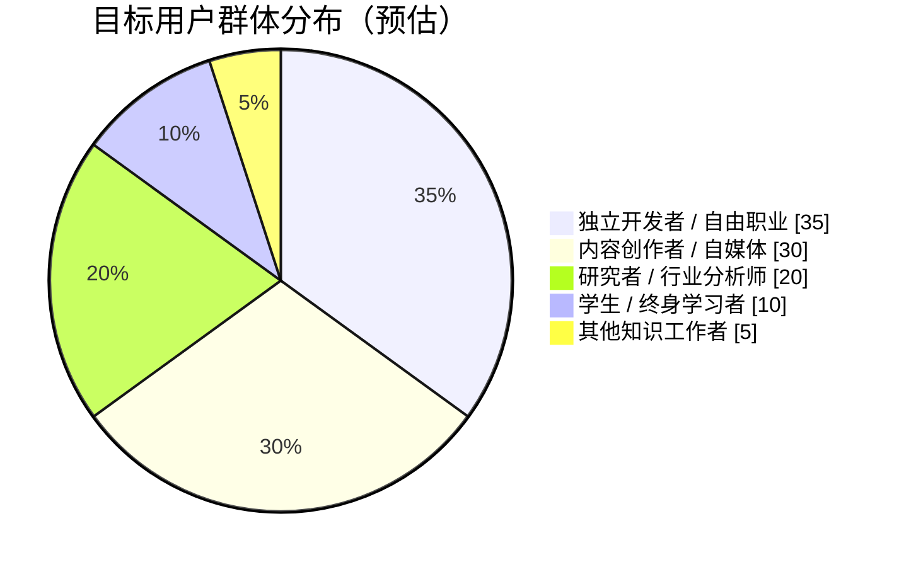
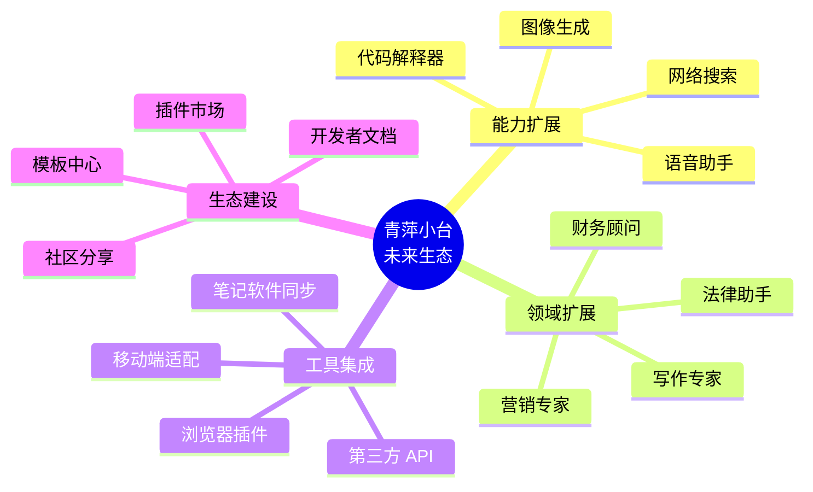
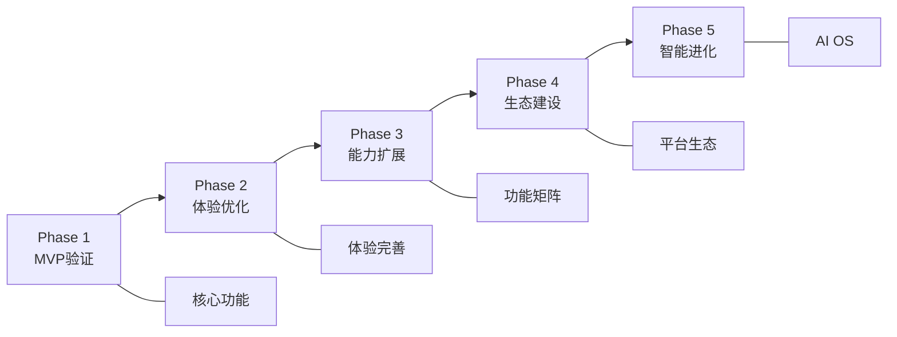

# 青萍小台 产品愿景画布

> PRODUCT VISION CANVAS
>
> 青萍小台
>
> "每个人都值得拥有一个懂自己的 AI 智囊团"
>
> - 产品定位：个人 AI 工作台
> - 目标用户：知识工作者
> - 核心能力：知识库 + 多智能体
> - 部署方式：私有化部署

## 目录

1. 愿景宣言
2. 目标用户
3. 核心问题
4. 价值主张
5. 核心功能
6. 差异化优势
7. 商业模式
8. 成功指标
9. 产品路线图
10. 风险与对策

---

## 概览：愿景画布一图流

以下画布以可视化方式呈现青萍小台的产品愿景全貌，涵盖从用户痛点到解决方案、从核心功能到商业模式的完整思考框架。

### 愿景宣言

**打造每个人的私有化 AI 工作台** —— 以知识库为数据底座，以多智能体专家组为能力核心，让知识工作者拥有一个"懂自己"的 AI 智囊团，显著提升创作、研究和开发效率。

### 目标用户

- 独立开发者 / 自由职业者
- 内容创作者 / 自媒体人
- 研究者 / 行业分析师
- 重视数据隐私的技术用户

### 核心问题

- 个人知识资产分散，无法被 AI 利用
- 通用 AI 不懂个人上下文
- 复杂任务单角色 AI 能力有限
- SaaS 模式数据隐私有顾虑

### 价值主张

- **懂你：**基于个人知识库的 RAG 增强
- **高效：**多智能体协作处理复杂任务
- **安全：**私有化部署，数据完全可控
- **成长：**知识资产可积累可复用

### 核心功能（MVP 三大模块）

**知识库模块**

- 多格式文档上传
- 智能文本解析
- 向量存储与检索
- 语义搜索

**技术专家组**

- 四大专家角色
- 状态图式协作（State Graph）
- 人工介入点（Human-in-the-loop）
- 预留 Loop 扩展接口
- SSE 流式输出
- 知识库 RAG 接入

**系统管理**

- 插件化架构
- 动态菜单加载
- 系统配置中心
- 可扩展设计

### 差异化优势

- 私有化部署 vs SaaS
- 状态图式协作 vs 流水线式串行
- 多智能体协作 vs 单对话
- 深度知识库集成 vs 通用问答
- 插件化可扩展 vs 封闭系统

### 商业模式

- **定位：**个人效率工具
- **核心：**开源 + 增值服务
- **长期：**插件生态 / 模板市场
- **价值：**时间节省 > 订阅费用

### 成功指标

- **北极星：**日均使用时长
- **留存：**30日留存 > 20%
- **深度：**人均 > 15 轮对话/天
- **迭代效率：**任务平均迭代轮次 < 3 轮
- **口碑：**NPS > 40

---

## 01 愿景宣言

### 一句话愿景

**让每个人都拥有一个懂自己的私有化 AI 智囊团**

青萍小台致力于为知识工作者打造一个可私有化部署的个人 AI 工作台。我们相信，真正高效的 AI 不是一个通用的聊天机器人，而是一个深度理解用户知识体系、工作习惯和目标追求的"智能伙伴"。通过知识库 + 多智能体的组合，让 AI 从"工具"进化为"搭档"，陪伴用户持续成长，释放每个人的创造潜能。

### 1.1 愿景阐述

**关于"青萍"**

"青萍之末"，源自"风起于青萍之末"。每一个伟大的创造都始于微小的起点，青萍小台愿成为每一位知识工作者创意风暴的起点，陪伴用户从点滴积累到厚积薄发。

**关于"小台"**

"台"即工作台，是每个人施展才华的阵地。小而美，精而专 —— 不追求大而全，而是聚焦于"真正有用"的核心能力，让工具回归服务于人本身的本质。

#### 三大核心理念

**以人为本**

工具是人的延伸，而非人的束缚。青萍小台始终以用户的真实需求为出发点，让技术服务于人，而非让人适应技术。

**长期主义**

个人知识资产的积累是一场长跑。我们不追求短期的流量和热度，而是致力于打造一个用户可以信赖、可以长期使用的工具。

**开放共生**

插件化架构让产品拥有无限可能。我们相信开放的力量，让每个用户都能根据自己的需求定制专属的工作台。

---

## 02 目标用户

### 2.1 核心用户群

青萍小台的目标用户是以知识工作和创意生产为核心的个人用户。他们对 AI 工具有较高的接受度，追求效率提升和知识沉淀，同时重视数据隐私和工具的个性化定制能力。

*图 2-1 目标用户群体分布预估*

### 2.2 用户画像卡片

#### 李明 · 独立开发者

核心用户 · PERSONA-01 | 28岁 | 自由职业

需求关键词

- 代码生成与审查
- 项目文档快速生成
- 技术方案设计
- 代码库知识管理

#### 张小雨 · 创作者

核心用户 · PERSONA-02 | 32岁 | 自媒体

需求关键词

- 素材管理与检索
- 选题策划与大纲
- 多平台内容适配
- 个人写作风格模仿

#### 王博士 · 研究员

重要用户 · PERSONA-03 | 35岁 | 咨询公司

需求关键词

- 文献资料管理
- 跨文档对比分析
- 文献综述生成
- 引用溯源与验证

### 2.3 用户分层

| 用户层级 | 特征 | 核心诉求 | 占比预估 |
|---------|------|---------|---------|
| **种子用户** | 技术爱好者、独立开发者、AI 工具重度使用者 | 追求极致效率，愿意折腾，愿意反馈 | 15% |
| **核心用户** | 专业知识工作者，日常需要处理大量信息和文档 | 稳定可靠，能真正提升工作效率 | 60% |
| **潜在用户** | 对 AI 工具感兴趣但还没找到合适的 | 简单易用，学习成本低 | 25% |

---

## 03 核心问题

在 AI 工具日益普及的今天，个人知识工作者仍然面临着诸多未被满足的需求。我们通过用户访谈和市场调研，总结出以下六大核心痛点：

**PAIN 01 — 知识资产沉睡**

个人知识分散在笔记、文档、浏览器收藏夹、聊天记录等各个角落，形成了一座座"数据孤岛"。这些宝贵的知识资产无法被 AI 有效利用，每次使用 AI 都要从零开始，无法站在自己已有知识的肩膀上。

**PAIN 02 — AI 不懂"我"**

通用 AI 助手就像一个刚认识的陌生人，每次对话都需要重新铺垫背景、解释上下文。它不了解你的专业领域、工作风格、知识积累，给出的回答往往"正确但无用"。

**PAIN 03 — 复杂任务能力有限**

单角色 AI 在面对复杂任务时力不从心 —— 既做架构设计又写代码还写文档，结果往往样样通样样松。用户需要在不同工具和 Prompt 之间反复切换，上下文断裂，效率反而更低。

**PAIN 04 — 数据隐私顾虑**

SaaS 模式下，用户的文档、代码、创意都存储在第三方服务器上。对于涉及商业机密、个人隐私的内容，用户不敢放心使用，这大大限制了 AI 工具的使用场景和深度。

**PAIN 05 — 工具碎片化**

写作用一个工具、编程用一个工具、查资料又用一个工具，每个工具都有自己的账号、自己的界面、自己的使用习惯。用户在工具之间疲于奔命，真正花在创造上的时间反而减少了。

**PAIN 06 — 知识无法积累**

今天和 AI 的对话，明天就找不到了；这次整理的资料，下次又要重新搜索。使用 AI 的过程本身没有转化为可积累的资产，每次都是"一次性消费"。

---

## 04 价值主张

青萍小台围绕用户的核心痛点，从四个维度创造独特的用户价值：

### 懂你的 AI

基于个人知识库的 RAG 检索增强，让 AI 回答融入你的知识积累和语境。用得越久，AI 越懂你，回答越精准。从"通用回答"升级为"专属建议"。

### 高效协作

多智能体协作模式，让不同专长的 AI 专家分工处理复杂任务。状态图式协作取代单向流水线，支持回退、循环与跳转，关键节点人工介入确认，从需求到交付一站式完成。

### 数据自主

私有化部署模式，所有数据存储在你自己的服务器上。知识资产完全自主可控，消除数据隐私顾虑，放心使用敏感资料。

### 持续成长

知识库越用越丰富，AI 能力越用越强。插件化架构支持功能扩展，工作台随你的成长同步进化，永不过时。

> **核心价值公式：**
>
> 个人知识资产 × 多智能体能力 × 私有化安全 = 指数级效率提升

---

## 05 核心功能

### 5.1 MVP 三大核心模块

#### 知识库模块

KNOWLEDGE BASE · 数据底座

- 多格式文档上传（MD/PDF/TXT/Word）
- 智能文本解析与结构保留
- 语义分块与重叠策略
- 向量存储与索引构建
- 语义检索与相似度匹配
- 知识库分类管理
- 文档在线预览
- 批量上传与管理
- 检索结果原文定位

#### 技术专家组模块

TECH EXPERTS · 能力核心

- 架构师专家（系统设计）
- 程序员专家（代码实现）
- 文档工程师（文档编写）
- 测试工程师（质量保障）
- 单专家对话模式
- 状态图式协作（State Graph）
- 人工介入点（关键节点确认）
- 可回退、可循环、可跳转
- SSE 流式输出
- 知识库 RAG 接入
- 会话历史管理

#### 系统管理模块

SYSTEM ADMIN · 扩展底座

- 插件化架构设计
- 插件启用/禁用管理
- 菜单动态加载
- 系统配置中心
- AI 模型参数配置
- 用户信息管理
- API Key 安全存储
- 使用数据统计
- 模块化扩展接口

### 5.2 未来扩展模块

*图 5-1 未来扩展模块全景图*

| 扩展方向 | 模块名称 | 核心价值 | 规划阶段 |
|---------|---------|---------|---------|
| **能力扩展** | 语音助手 | 语音输入输出，解放双手 | Phase 2 |
| **能力扩展** | 图像生成 | 文生图、图生图能力 | Phase 2 |
| **能力扩展** | 代码解释器 | 沙箱环境执行代码，数据处理可视化 | Phase 3 |
| **领域扩展** | 创作专家包 | 写作、文案、剧本等创作类专家 | Phase 2 |
| **领域扩展** | 研究专家包 | 文献综述、数据分析、报告撰写 | Phase 3 |
| **领域扩展** | 自定义智能体 | 用户自定义专家角色和能力 | Phase 3 |
| **工具集成** | 浏览器剪藏 | 一键保存网页内容到知识库 | Phase 2 |
| **工具集成** | 笔记软件同步 | 与 Notion / Obsidian 等双向同步 | Phase 3 |
| **工具集成** | 移动端适配 | 手机 / 平板端优化体验 | Phase 4 |
| **生态建设** | 插件市场 | 第三方开发者贡献插件 | Phase 4 |
| **生态建设** | 模板中心 | 工作流模板、Prompt 模板分享 | Phase 3 |

---

## 06 差异化优势

与市面上的通用 AI 助手相比，青萍小台在以下维度形成了显著的差异化竞争优势：

| 对比维度 | 青萍小台 | 通用 AI 助手（ChatGPT / Claude 等） |
|---------|---------|----------------------------------|
| 部署方式 | 私有化部署，数据完全自主；部署在用户自己的云服务器；无第三方数据隐私风险 | SaaS 模式，数据存储在服务商；用户无法控制数据去向；敏感内容使用受限 |
| 知识能力 | 深度集成个人知识库；RAG 检索增强，回答基于个人知识；知识资产可积累、可复用 | 依赖模型训练时的通用知识；上下文窗口有限，无法承载大量个人知识；知识无法持久化积累 |
| 协作模式 | 多智能体分工协作；状态图式协作，可回退、可循环、可跳转；关键节点人工介入确认（Human-in-the-loop）；不同专家各司其职，输出质量更高 | 单角色对话；流水线式串行，不可回退不可循环；需要用户手动引导多步骤任务；复杂任务效果不稳定 |
| 扩展性 | 插件化架构，功能可自由扩展；支持自定义专家角色；开放 API，可与其他工具集成 | 封闭系统，功能由服务商决定；定制化能力有限；依赖官方更新迭代 |
| 产品定位 | 个人 AI 工作台；围绕知识工作者的完整工作流；工具 + 知识 + 能力的整合平台 | 通用对话机器人；面向大众的泛用型工具；单点功能，需与其他工具配合 |
| 成本模式 | 开源免费 + 自愿付费；用户自备 API Key，用量自主控制；服务器成本固定，边际成本低 | 订阅制 / 按量付费；高级功能需付费解锁；长期使用成本较高 |

> **核心差异化：**
>
> 通用 AI 助手做的是"广度" —— 让更多人能用；青萍小台做的是"深度" —— 让知识工作者用得更好、更深入、更放心。我们不追求成为所有人的工具，而是成为特定人群离不开的工具。

---

## 07 商业模式

### 7.1 定位：个人效率工具

青萍小台的本质是一款个人效率工具，核心价值在于帮助知识工作者节省时间、提升产出质量。我们的商业模式围绕"为用户创造的价值"来设计，确保产品价值始终大于用户付出的成本。

**开源核心**

核心功能开源免费，降低使用门槛，建立用户信任，通过社区推动产品迭代。

**增值服务**

高级插件、专业模板、技术支持等增值服务，为有更高需求的用户提供价值。

**生态价值**

长期构建插件生态和模板市场，形成平台效应和网络效应。

### 7.2 长期价值创造

#### 用户端价值

**效率提升**

- 文档处理时间减少 50%+
- 信息检索效率提升 3 倍
- 复杂任务处理时间缩短 60%
- 重复性工作自动化

**质量提升**

- 多角色交叉验证，减少疏漏
- 知识库支撑，回答更准确
- 结构化输出，成果更专业
- 知识积累，能力持续增长

#### 产品端价值

**社区驱动**

- 开源社区贡献代码和插件
- 用户反馈驱动产品迭代
- 模板和工作流社区共享
- 口碑传播，降低获客成本

**可持续发展**

- 增值服务覆盖开发成本
- 插件市场形成平台效应
- 用户成功 = 产品成功
- 长期主义，稳步成长

> **商业哲学：**
>
> 最好的商业模式是"用户因为产品获得了巨大价值，而愿意主动分享一部分价值给产品"。青萍小台的目标不是从用户身上赚钱，而是帮用户赚钱（省钱），然后从中获得合理的回报。

---

## 08 成功指标

### 8.1 北极星指标

**日均使用时长 > 45 分钟**

北极星指标：衡量产品为用户创造的持续价值。用户愿意每天花多少时间在产品上，是产品价值最直接的体现。

> **为什么选择"日均使用时长"作为北极星指标？**
>
> 作为个人效率工具，用户的"使用时长"代表了产品融入用户工作流的深度。如果用户每天都愿意打开并长时间使用，说明产品真正解决了问题、创造了价值。相较于 DAU（日活），使用时长更能反映产品的"粘性"和"不可替代性"。

### 8.2 关键指标体系

| 指标 | 数值 |
|-----|------|
| 次日留存率 | > 60% |
| 7日留存率 | > 35% |
| 30日留存率 | > 20% |
| 人均日对话轮次 | > 15 轮 |

| 指标分类 | 指标名称 | 目标值（上线 3 个月） | 说明 |
|---------|---------|---------------------|------|
| **用户留存** | 次日留存率 | > 60% | 衡量首次使用体验 |
| **用户留存** | 7 日留存率 | > 35% | 衡量短期价值验证 |
| **用户留存** | 30 日留存率 | > 20% | 衡量长期价值认可 |
| **使用深度** | 日均对话轮次 | > 15 轮 | 衡量产品融入工作流的深度 |
| **使用深度** | 知识库文档数 | 人均 > 20 篇 | 衡量知识库模块的使用程度 |
| **使用深度** | 多智能体使用率 | > 60% 活跃用户 | 衡量核心功能的渗透率 |
| **性能体验** | SSE 首字节时间 | < 1.5 秒 | 衡量对话流畅度 |
| **性能体验** | 检索响应时间 | < 2 秒 | 衡量知识库检索效率 |
| **用户口碑** | NPS 净推荐值 | > 40 | 衡量用户满意度和推荐意愿 |
| **用户口碑** | 功能满意度 | > 4.2 / 5.0 | 核心功能的用户评分 |

---

## 09 产品路线图

青萍小台采用渐进式发展策略，从 MVP 起步，逐步完善功能和生态。整个路线图分为五个阶段，预计 12-18 个月完成。

### Phase 1 · MVP — 第 0-2 个月

**基础验证：跑通核心价值**

聚焦核心功能的最小可用版本，验证"知识库 + 多智能体"的产品价值假设。

- 用户系统（注册 / 登录 / 个人中心）
- 知识库模块（文档上传 / 解析 / 向量化 / 语义检索）
- 技术专家组（四大专家 / 状态图式协作 / 人工介入 / SSE 流式输出）
- RAG 检索增强
- 插件化基础架构
- Docker 一键部署

**里程碑：**MVP 发布，种子用户内测，验证核心价值

### Phase 2 · 体验优化 — 第 3-5 个月

**体验打磨：让用户用得更爽**

基于 MVP 用户反馈，优化核心体验，扩展基础功能，提升产品易用性和稳定性。

- 更多文档格式支持（PPT / Excel / Epub / 网页剪藏）
- 半自动 Loop + Evaluator（验收标准可配置）
- 多专家圆桌讨论模式
- 会话模板与工作流保存
- 浏览器剪藏插件
- 语音输入输出
- 移动端响应式优化
- 性能优化与稳定性提升

**里程碑：**产品体验完善，早期用户留存达标

### Phase 3 · 能力扩展 — 第 6-9 个月

**能力升级：更多专家，更强能力**

扩展专家角色和 AI 能力，支持自定义智能体，构建模板中心，丰富产品功能矩阵。

- 全自动 Loop 工程（多轮自主迭代）
- 自定义智能体（用户自己创建专家角色）
- 更多领域专家包（创作 / 研究 / 营销等）
- 代码解释器（沙箱代码执行）
- 图像生成能力
- 工作流模板中心
- 笔记软件同步（Notion / Obsidian）
- 混合检索（语义 + 关键词）

**里程碑：**功能矩阵完善，覆盖更多使用场景

### Phase 4 · 生态建设 — 第 10-14 个月

**生态构建：从工具到平台**

开放插件生态，建立开发者社区，从单一产品进化为平台型产品。

- 插件市场（第三方开发者上传插件）
- 开发者文档与 SDK
- 开放 API 接口
- 主题 / 皮肤系统
- 社区分享与讨论区
- 多语言支持

**里程碑：**插件生态初步建立，开发者社区形成

### Phase 5 · 长期愿景 — 第 15 个月 +

**智能进化：个人 AI 操作系统**

从"AI 工作台"进化为"AI 操作系统"，成为个人数字生活的核心入口。

- 自研轻量化模型（降低使用成本）
- 多模态知识管理（文本 / 图片 / 音频 / 视频）
- 智能体自主学习（从用户行为中学习）
- 跨设备同步与协作
- 个人 AI 助手 OS 化

**愿景：**每个人都拥有一个与自己共同成长的 AI 伙伴

*图 9-1 产品路线图演进示意*

---

## 10 风险与对策

在产品发展过程中，我们识别了以下主要风险，并制定了相应的应对策略：

### 技术风险 [高]

大模型 API 不稳定、效果不达预期、Embedding 质量波动等，可能影响核心功能体验。

**对策：**

- 封装模型抽象层，支持快速切换模型服务商
- 建立效果评估体系，持续监控输出质量
- 关键场景提供 Fallback 方案
- 预留本地模型部署能力

### 产品风险 [高]

产品价值假设不成立，用户觉得"不好用"或"用不着"，留存率和使用频率达不到预期。

**对策：**

- MVP 阶段快速验证，小步快跑迭代
- 建立用户反馈渠道，持续收集需求
- 聚焦核心价值，不盲目扩展功能
- 数据驱动决策，用指标验证假设

### 竞争风险 [中]

大厂或竞品快速跟进类似功能，凭借资源优势挤压产品生存空间。

**对策：**

- 聚焦细分人群，做深做透垂直场景
- 私有化部署构建差异化壁垒
- 社区和生态形成网络效应
- 快速迭代，保持产品领先半步

### 成本风险 [中]

AI 调用成本过高，导致用户使用不起或产品无法持续运营。

**对策：**

- 用户自备 API Key，用量自主控制
- 优化 Prompt 和检索策略，降低 Token 消耗
- 支持本地模型，完全离线使用
- 提供成本控制和用量提醒功能

### 安全风险 [中]

私有化部署场景下，用户安全意识不足，可能导致数据泄露或系统被入侵。

**对策：**

- 默认安全配置，开箱即用
- 提供安全加固指南和最佳实践
- 敏感数据加密存储
- 定期安全审计和更新

### 团队风险 [中]

初期团队规模小，人力有限，开发进度和质量可能受影响。

**对策：**

- 聚焦 MVP，控制功能范围
- 开源社区参与，众包开发
- 优先保证核心功能质量
- 非核心功能延后迭代

> **风险应对总原则：**
>
> 快速验证、小步迭代、聚焦核心、预留退路。不追求完美，追求"足够好"的持续进化。保持敏捷，随时根据市场反馈调整方向。

---

*青萍小台 · Product Vision Canvas · v1.0 · 2026*